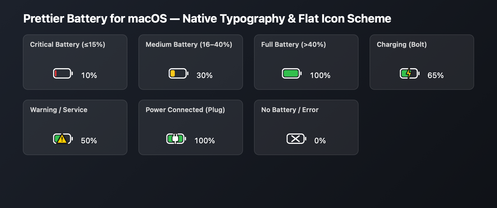

# Prettier Battery for macOS

<p align="center">
  
</p>

<p align="center">
  <a href="#-features">Features</a> •
  <a href="#-installation">Installation</a> •
  <a href="#-how-to-hide-the-default-macos-battery-icon">Hide Default Icon</a> •
  <a href="#-building-from-source">Building from Source</a> •
  <a href="#-license">License</a>
</p>

---

A sleek, lightweight, and modern **flat battery monitor** for the macOS menu bar. Designed to replace the default chunky battery icon with clean geometric lines, high-contrast dynamic colors, and pixel-perfect native typography.

---

## ✨ Features

- **Modern Flat Icon Scheme**:
  - **Critical Battery (≤15%)**: Clean red indicator.
  - **Medium Battery (16%–40%)**: High-visibility amber/yellow indicator.
  - **Full / Normal Battery (>40%)**: Crisp green fill proportional to exact battery level.
  - **Charging (Bolt)**: High-contrast lightning bolt overlay with golden/white fill.
  - **Power Connected (Plug)**: Power plug icon when connected to AC power and fully charged.
  - **Warning / Service Required**: Attention indicator (`⚠️`) if battery service is recommended.
  - **No Battery / Error**: Clean `X` badge.
- **Color Schemes**:
  - **Dynamic (Default)**: Crisp white outline with vivid Red / Yellow / Green status fill.
  - **Native Monochrome**: Automatically adapts to Light and Dark menu bar themes via macOS template rendering.
- **Pixel-Perfect Native Typography**:
  - Uses the exact system menu bar font (`.AppleSystemUIFont` / SF Pro with monospaced digits at 13pt).
  - Matches the baseline alignment, weight, and size of the macOS clock and Control Center items.
- **Real-Time Technical Statistics**:
  - **Official Battery Health** (Maximum Capacity % matching macOS System Settings).
  - **Cycle Count**.
  - **Real-Time Power Draw / Charge Rate** (in Watts).
  - **Voltage and Amperage** (in Volts and mA).
  - **Accurate Time Remaining** (time until empty or time until 100% full charge).
- **Flexible Menu Bar Display**:
  - Icon Only
  - Icon + Percentage
  - Icon + Time Remaining
  - Percentage Only
- **Ultra Lightweight & Native**:
  - Written in pure Objective-C / Cocoa with IOKit.
  - Near zero CPU usage (<0.1%) and negligible RAM footprint (<15 MB).
  - Event-driven IOKit notifications for instant updates when plugging/unplugging power.
  - Built-in **Launch at Login** support via `SMAppService`.

---

## 🚀 Installation

### Option 1: Using the Pre-built DMG Installer

1. Download or build the [`PrettierBattery.dmg`](PrettierBattery.dmg) installer.
2. Double-click `PrettierBattery.dmg` to mount the disk image.
3. Drag **Prettier Battery** into your **Applications** folder.
4. Launch **Prettier Battery** from your Applications folder or Launchpad.

---

## 💡 How to Hide the Default macOS Battery Icon

To enjoy a clean menu bar with only Prettier Battery:

1. Open **System Settings** on your Mac.
2. Navigate to **Control Center** in the sidebar.
3. Scroll down to the **Battery** section.
4. Change the setting to **"Don't Show in Menu Bar"**.

---

## 🛠️ Building from Source

### Prerequisites
- macOS 11.0 (Big Sur) or newer.
- Apple Command Line Tools (`xcode-select --install`).

### Build Commands

```bash
# Build the application and generate the .dmg installer
make dmg

# Or build only the .app bundle (output to build/PrettierBattery.app)
make build

# Run directly from source
make run

# Clean build artifacts
make clean
```

---

## 📁 Project Structure

```
prettier-battery-icon/
├── Info.plist                  # macOS Application Bundle metadata
├── Makefile                    # Automation tasks (build, dmg, run, clean)
├── README.md                   # Project documentation
├── LICENSE                     # MIT License
├── .gitignore                  # Git ignore rules
├── docs/
│   └── preview.png             # Visual preview of battery states
├── scripts/
│   ├── build.sh                # Native compilation & code-signing script
│   ├── create_dmg.sh           # DMG disk image creation script
│   ├── generate_icon.m         # AppIcon generator script
│   └── generate_preview.m      # Preview renderer script
└── src/
    ├── main.m                  # Application entry point
    ├── AppDelegate.h / .m      # Menu bar controller & preferences
    ├── BatteryInfo.h / .m      # Battery telemetry data model
    ├── BatteryMonitor.h / .m   # IOKit & power source monitoring engine
    └── BatteryIconRenderer.h / .m # Flat vector icon renderer
```

---

## 📄 License

This project is licensed under the MIT License — see the [LICENSE](LICENSE) file for details.
